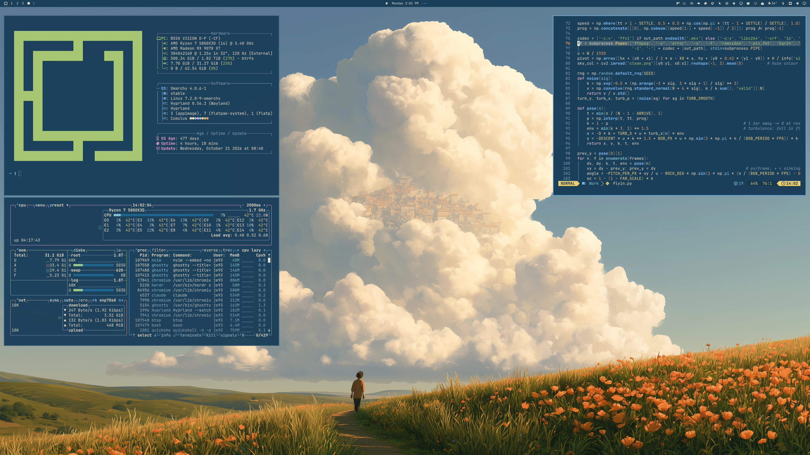

# Cumulus

A summer sky behind towering clouds: painted-sky blue, cloud cream and poppy orange. A dark theme for Omarchy.



## Install

For **Omarchy 4 with Omarchy Shell**:

```sh
omarchy theme install https://github.com/erikrjohansson/omarchy-cumulus-theme
```

Use `omarchy theme bg next` to switch between the four wallpapers.

## Update

```sh
omarchy theme update
```

## Remove

```sh
omarchy theme remove cumulus
```

## The theme

- Windows, menus and notifications in the painting's sky blue, with cloud cream text and a pale sky accent.
- Terminal colors taken from the wallpapers: sky, cloud, meadow green and poppy orange.
- Blue Yaru folder icons.
- A boot screen in the theme's colors: pick it in the Omarchy menu under Style → Unlock.
- Application configs derive from `colors.toml` through Omarchy templates.

## Wallpapers

Four **6688 × 3764** wallpapers: cloud town (default, above), cottage, airship and lighthouse.

<table>
  <tr>
    <td width="33%"></td>
    <td width="33%"></td>
    <td width="33%"></td>
  </tr>
  <tr>
    <td align="center">Cottage</td>
    <td align="center">Airship</td>
    <td align="center">Lighthouse</td>
  </tr>
</table>

## Boot intros

Each wallpaper has a short boot intro that ends on the wallpaper. They play on Omarchy 4.5 and later. Click one for the full-resolution video.

<table>
  <tr>
    <td width="50%"><a href="backgrounds/intros/01-cloud-town-path.mp4"></a></td>
    <td width="50%"><a href="backgrounds/intros/02-cottage.mp4"></a></td>
  </tr>
  <tr>
    <td align="center">The cloud opens to reveal the town</td>
    <td align="center">The cloud builds up behind the cottage</td>
  </tr>
  <tr>
    <td width="50%"><a href="backgrounds/intros/03-airship.mp4"></a></td>
    <td width="50%"><a href="backgrounds/intros/04-lighthouse.mp4"></a></td>
  </tr>
  <tr>
    <td align="center">The airship flies in</td>
    <td align="center">The cloud rises from the sea</td>
  </tr>
</table>

## License

[MIT](LICENSE) · [Omarchy artwork attribution](THIRD_PARTY_NOTICES.md)
